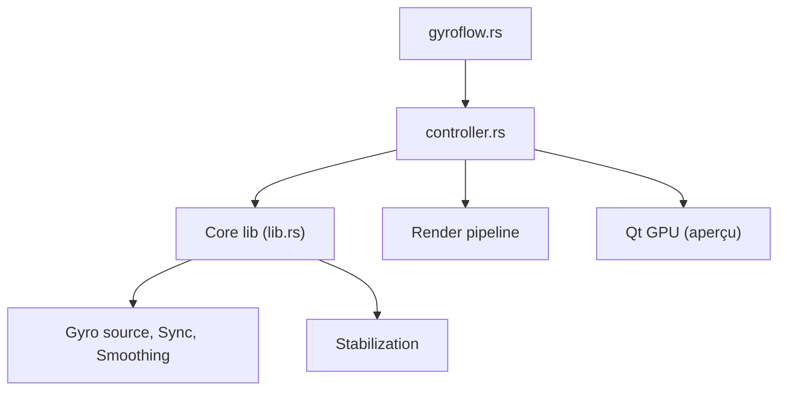

# gyroflow/gyroflow

> Application qui stabilise une vidéo à partir des données de gyroscope de la caméra.

## Le problème
Les stabilisations logicielles sans capteur dégradent l'image ; les caméras enregistrent pourtant leur mouvement.

## Ce que ça fait vraiment
Lit les données gyroscope de GoPro, Sony, Insta360 ou d'un enregistreur externe, les synchronise avec la vidéo, lisse l'orientation et applique correction d'objectif et zoom adaptatif. Rendu accéléré par GPU, plugins pour éditeurs vidéo, écrit en Rust avec interface QML.

## Comment c'est branché


## Essayer
```bash
brew install gyroflow
cargo install --force just
just install-deps
just run
```

## Coût et pièges
Gratuit. GPU et pilotes graphiques à jour conseillés. Le binaire lie mdk-sdk, propriétaire : licence GPLv3 avec permission supplémentaire. Compilation lourde sur chaque plateforme.

## Ce que ce n'est pas
Pas un éditeur vidéo complet. Ne stabilise bien que s'il existe des données de mouvement.

## Alternatives
Aucune alternative nommée dans le README.

## Pour toi
À ignorer : traitement vidéo grand public, sans rapport avec ton travail data / IA / MLOps.

