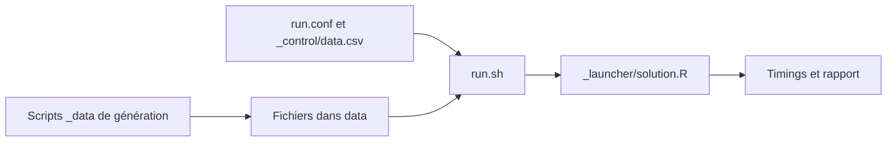

# h2oai/db-benchmark

> Reproducible benchmark of database-like operations on a single machine, to compare pandas, Polars, DuckDB and others.

## The problem
Choosing between pandas, Polars, DuckDB, Spark or data.table requires comparable measurements across data size and complexity.

## What it actually does
A set of scripts measures timings for three tasks (groupby, join, groupby2014) on a dozen solutions: dask, data.table, dplyr, DataFrames.jl, pandas, datatable, Spark, cuDF, ClickHouse, Polars, Arrow, DuckDB. Data is generated with R scripts, then you run `run.sh` or a single solution. A report is published at h2oai.github.io/db-benchmark.

## How it is wired
Simplified diagram based on the fiche, no diagram provided.


## Trying it
```bash
Rscript _data/groupby-datagen.R 1e7 1e2 0 0
./run.sh
./_launcher/solution.R --solution=data.table --task=groupby --nrow=1e7
```

## Cost and gotchas
The README cites an r3.8xlarge machine (244 GB of RAM, 32 cores) as an example; each solution must be installed by hand, with R, Python, Julia and Java. The last push dates from June 2023: results are no longer updated.

## What it is not
Not a library: it is a test bench. Some timings are missing, when a solution runs out of memory or exceeds a time limit.

## Alternatives
No alternative named in the README.

## For you
Worth watching: the published results help choose between pandas, Polars and DuckDB, but the repo has not moved since June 2023, so cross-check with recent measurements.
