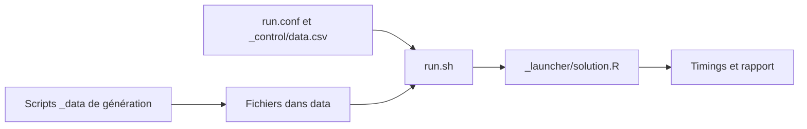

# h2oai/db-benchmark

> Benchmark reproductible d'opérations de type base de données sur une machine, pour comparer pandas, Polars, DuckDB et d'autres.

## Le problème
Choisir entre pandas, Polars, DuckDB, Spark ou data.table demande des mesures comparables sur la taille et la complexité des données.

## Ce que ça fait vraiment
Un ensemble de scripts mesure les temps pour trois tâches (groupby, join, groupby2014) sur une douzaine de solutions : dask, data.table, dplyr, DataFrames.jl, pandas, datatable, Spark, cuDF, ClickHouse, Polars, Arrow, DuckDB. On génère des données avec des scripts R, puis on lance `run.sh` ou une seule solution. Un rapport est publié sur h2oai.github.io/db-benchmark.

## Comment c'est branché
Schéma simplifié d'après la fiche, sans diagramme fourni.


## Essayer
```bash
Rscript _data/groupby-datagen.R 1e7 1e2 0 0
./run.sh
./_launcher/solution.R --solution=data.table --task=groupby --nrow=1e7
```

## Coût et pièges
Le README cite une machine r3.8xlarge (244 Go de RAM, 32 cœurs) comme exemple ; il faut installer chaque solution à la main, avec R, Python, Julia et Java. Le dernier push date de juin 2023 : les résultats ne sont plus mis à jour.

## Ce que ce n'est pas
Pas une bibliothèque : c'est un banc d'essai. Certains timings manquent, quand une solution manque de mémoire ou dépasse un délai.

## Alternatives
Aucune alternative nommée dans le README.

## Pour toi
À surveiller : les résultats publiés aident à choisir entre pandas, Polars et DuckDB, mais le dépôt n'a plus bougé depuis juin 2023, donc à croiser avec des mesures récentes.

