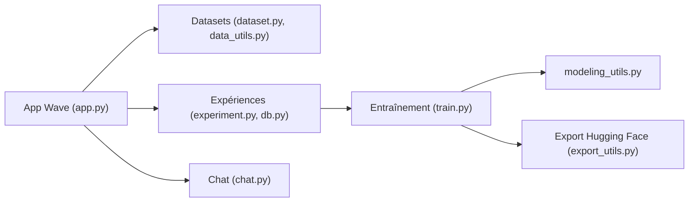

# h2oai/h2o-llmstudio

> Graphical interface and CLI to fine-tune LLMs without coding, for AI practitioners with an NVIDIA GPU.

## The problem
LLM fine-tuning requires scripts, hyperparameters and experiment tracking; few people want to wire it all up.

## What it actually does
An H2O Wave application manages projects, datasets and experiments. It trains with LoRA and 8-bit quantization, DPO/IPO/KTO (RLHF removed), causal regression and classification, with DeepSpeed across several GPUs. Evaluation by metrics and by judge, visual comparison, W&B integration, chat with the model, export to Hugging Face. The same pipeline can be used from the CLI with a YAML file.

## How it is wired


## Trying it
```bash
make setup
make llmstudio
uv run python llm_studio/train.py -Y {path_to_config_yaml_file}
```

## Cost and gotchas
NVIDIA GPU (24 GB of memory recommended for large models), Ubuntu 16.04+, drivers ≥ 470.57.02; DeepSpeed requires the CUDA Toolkit and NVLink. Backward compatibility is not guaranteed between versions: pin the version.

## What it is not
Not an inference or deployment platform. "No code" does not excuse you from preparing your data properly (format described in the docs).

## Alternatives
Not documented in the README: no alternative named.

## For you
Useful for prototyping a LoRA fine-tune with a visual interface if you have a GPU; if you already write your own training loops, the appeal is smaller.
