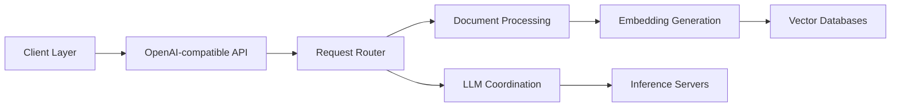

# h2oai/h2ogpt

> Chat and document Q&A interface with local or remote LLMs, now archived.

## The problem
Querying your documents with an LLM without sending them to a cloud service requires assembling ingestion, embeddings, a vector database and a UI.

## What it actually does
Ingestion of PDF, Office, images, audio, video, code into Chroma, Weaviate or FAISS; HYDE, semantic chunking.
Gradio UI or CLI, multi-model (HF, llama.cpp, GPT4ALL, vLLM, TGI, Ollama, commercial APIs).
OpenAI-compatible proxy server (chat, embeddings, STT/TTS, images, function calling), search/code/CSV agents.
Vision, image generation, voice, authentication.

## How it is wired


## Trying it
```bash
GPT_H2O_AI=0 CONCURRENCY_COUNT=1 pytest --instafail -s -v tests
```
Only test commands appear in the README; installation points to separate docs.

## Cost and gotchas
Free; GPU recommended, Docker advised for all features.
Archived repository: no more fixes.

## What it is not
No longer a living project; the enterprise version h2oGPTe is a separate product.
Many heavy dependencies.

## Alternatives
- pseudotensor/open-strawberry: CoT project cited by the README, with no direct relation.

## For you
Ignore: archived, so not to be adopted for a local RAG; remains a mine of ideas (HYDE, OpenAI proxy) worth rereading.
