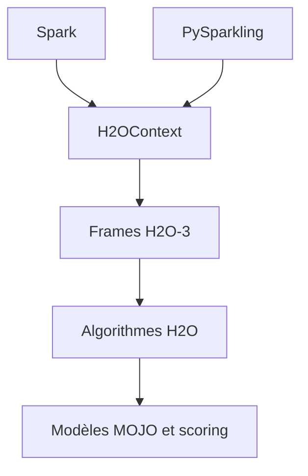

# h2oai/sparkling-water

> Integration of H2O-3 with Apache Spark to train models on Spark DataFrames, on the JVM and in PySpark.

## The problem
H2O-3 algorithms and Spark data live in two separate engines, with no direct conversion.

## What it actually does
- Converts Spark RDDs, DataFrames and Datasets to H2O frames and back.
- `H2OContext` starts the H2O services on the Spark cluster.
- Python interface PySparkling, plus a Sparkling shell.
- Two deployment modes, internal and external; Maven packages for scoring and training.

## How it is wired
Simplified diagram based on the sheet, no diagram provided.


## Trying it
```bash
export SPARK_HOME="/path/to/spark/installation"
export MASTER="local[*]"
bin/sparkling-shell
```
Then, in the shell: `import ai.h2o.sparkling._` and `val hc = H2OContext.getOrCreate()`.

## Cost and gotchas
A Spark cluster is required (Spark 2.3 to 3.5 depending on versions); Java and Scala (not listed in the prerequisites). Last push in November 2025.

## What it is not
Not a standalone framework: it depends on Spark and H2O-3. The documentation is versioned per Spark version.

## Alternatives
No alternative named in the README.

## For you
Worth watching: relevant if you have a Spark estate and use H2O; otherwise Spark ML is often enough.
