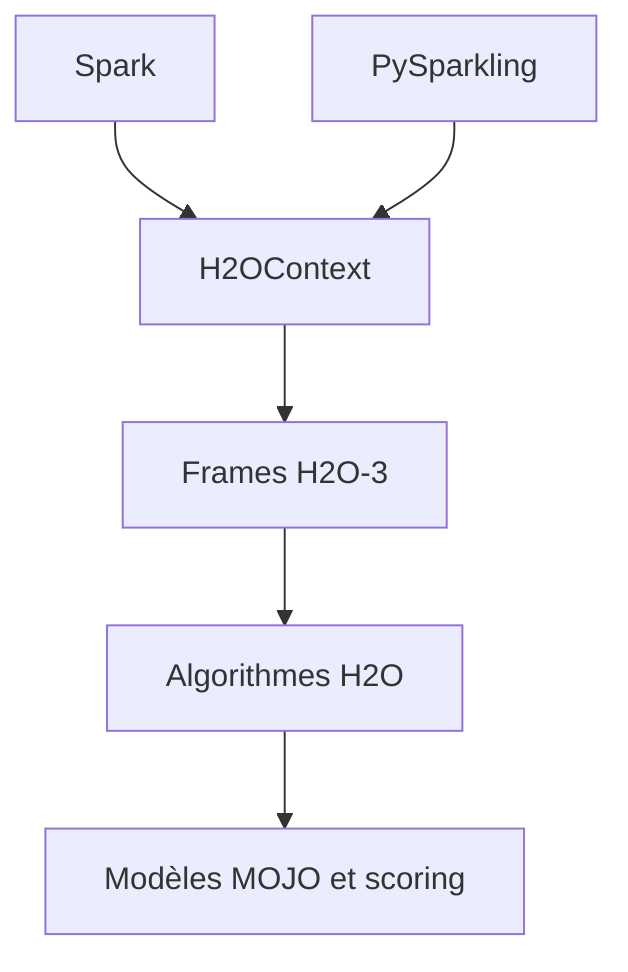

# h2oai/sparkling-water

> Intégration de H2O-3 à Apache Spark pour entraîner des modèles sur des DataFrames Spark, côté JVM et PySpark.

## Le problème
Les algorithmes de H2O-3 et les données Spark vivent dans deux moteurs distincts, sans conversion directe.

## Ce que ça fait vraiment
- Convertit RDD, DataFrames et Datasets Spark en frames H2O et inversement.
- `H2OContext` démarre les services H2O sur le cluster Spark.
- Interface Python PySparkling, plus un shell Sparkling.
- Deux modes de déploiement, interne et externe ; paquets Maven pour scoring et entraînement.

## Comment c'est branché
Schéma simplifié d'après la fiche, sans diagramme fourni.


## Essayer
```bash
export SPARK_HOME="/path/to/spark/installation"
export MASTER="local[*]"
bin/sparkling-shell
```
Puis, dans le shell : `import ai.h2o.sparkling._` et `val hc = H2OContext.getOrCreate()`.

## Coût et pièges
Un cluster Spark est requis (Spark 2.3 à 3.5 selon les versions) ; Java et Scala (non listés dans les prérequis). Dernier push de novembre 2025.

## Ce que ce n'est pas
Pas un framework autonome : il dépend de Spark et de H2O-3. Les documentations sont versionnées par version de Spark.

## Alternatives
Aucune alternative nommée dans le README.

## Pour toi
À surveiller : pertinent si tu as un parc Spark et utilises H2O ; sinon Spark ML suffit souvent.

