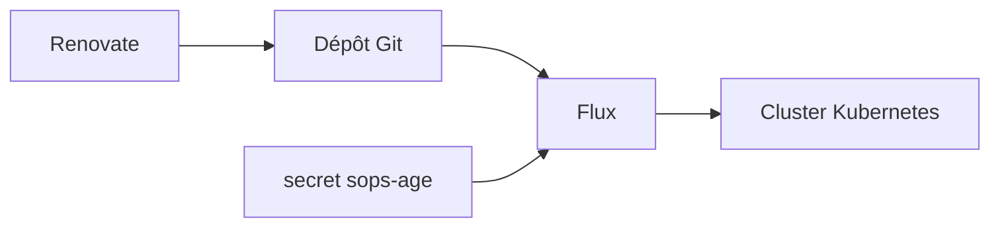

# h3mmy/bloopySphere

> GitOps repository of a personal Kubernetes cluster, managed by Flux and Renovate, useful as a homelab example.

## The problem
Maintaining a home cluster by hand makes configurations drift and leaves images up to date only by chance.

## What it actually does
Flux watches the repository and applies the manifests in the `cluster` folder. Renovate opens pull requests when a Docker image or Helm chart has a new version. The README is mostly a collection of kubectl snippets, ARM affinity rules and Loki queries. The external docs are struck through; nested READMEs replace them.

## How it is wired


## Trying it
```bash
kubectl apply --kustomize=./cluster/base/flux-system
kubectl get pods --field-selector status.phase=Failed -A
```

## Cost and gotchas
You need your own Kubernetes cluster and a sops/age key for secrets. The configuration is specific to this household: nothing to install as is.

## What it is not
It is not a product nor a turnkey reusable template: it is the author's personal configuration.

## Alternatives
No alternative named in the README.

## For you
Watch: a good Flux and Renovate GitOps example to read for inspiration, but not to deploy as is.
