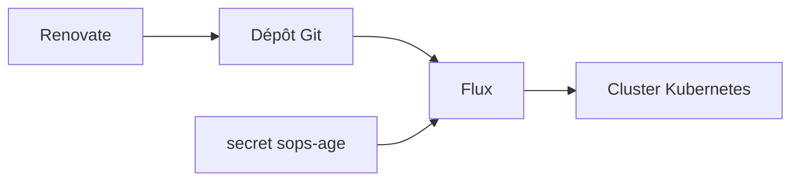

# h3mmy/bloopySphere

> Dépôt GitOps d'un cluster Kubernetes personnel, géré par Flux et Renovate, utile comme exemple de homelab.

## Le problème
Maintenir un cluster domestique à la main fait dériver les configurations et laisse les images à jour au hasard.

## Ce que ça fait vraiment
Flux surveille le dépôt et applique les manifestes du dossier `cluster`. Renovate ouvre des pull requests quand une image Docker ou un chart Helm a une nouvelle version. Le README est surtout un recueil d'extraits kubectl, de règles d'affinité ARM et de requêtes Loki. La doc externe est barrée ; des README imbriqués la remplacent.

## Comment c'est branché


## Essayer
```bash
kubectl apply --kustomize=./cluster/base/flux-system
kubectl get pods --field-selector status.phase=Failed -A
```

## Coût et pièges
Il faut un cluster Kubernetes à soi et une clé sops/age pour les secrets. La configuration est spécifique à ce foyer : rien à installer tel quel.

## Ce que ce n'est pas
Ce n'est pas un produit ni un modèle réutilisable clé en main : c'est la configuration personnelle de l'auteur.

## Alternatives
Aucune alternative nommée dans le README.

## Pour toi
À surveiller : bon exemple de GitOps Flux et Renovate à lire pour s'inspirer, mais à ne pas déployer tel quel.

