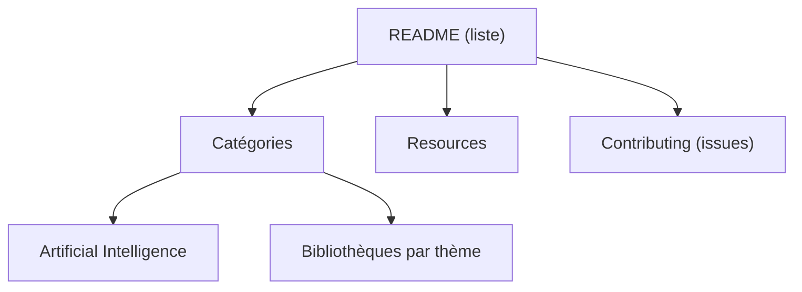

# h4cc/awesome-elixir

> Curated list of Elixir libraries, tools and resources, for developers of that language.

## The problem
Finding a reliable Elixir library among hundreds of scattered packages.

## What it actually does
Sorts libraries into categories: actors, algorithms, authentication, cache, code, cloud, AI, etc. Each entry has a one-line description. On the AI side: Nx (tensors), Axon (neural networks), AshAI, Jido, ReqLLM, ExLLama, Weaviate. The README provided is truncated mid-list.

## How it is wired
Simplified diagram based on the sheet, no diagram provided.

## Trying it
No documented command: you browse the list.

## Cost and gotchas
Free. No guarantee that the listed projects are maintained. Last push in October 2025.

## What it is not
Not a tool nor a benchmark: there is no testing and no quality ranking of the libraries.

## Alternatives
No alternative named in the README, apart from unnamed third-party sites.

## For you
Only useful if you write Elixir; the AI section (Nx, Axon) is a curiosity, not a choice for everyday ML, so ignore.
