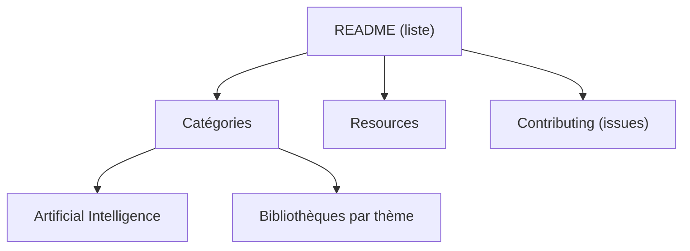

# h4cc/awesome-elixir

> Liste organisée de bibliothèques, outils et ressources Elixir, pour développeurs de ce langage.

## Le problème
Trouver une bibliothèque Elixir fiable parmi des centaines de paquets dispersés.

## Ce que ça fait vraiment
Classe des bibliothèques par catégories : acteurs, algorithmes, authentification, cache, code, cloud, IA, etc. Chaque entrée a une ligne de description. Côté IA : Nx (tenseurs), Axon (réseaux de neurones), AshAI, Jido, ReqLLM, ExLLama, Weaviate. Le README fourni est tronqué en cours de liste.

## Comment c'est branché
Schéma simplifié d'après la fiche, sans diagramme fourni.

## Essayer
Aucune commande documentée : on parcourt la liste.

## Coût et pièges
Gratuit. Aucune garantie de maintenance des projets listés. Dernier push d'octobre 2025.

## Ce que ce n'est pas
Ce n'est pas un outil ni un benchmark : il n'y a ni test ni classement de qualité des bibliothèques.

## Alternatives
Aucune alternative nommée dans le README, sauf des sites tiers non nommés.

## Pour toi
Utile seulement si tu écris du Elixir ; la section IA (Nx, Axon) est une curiosité, pas un choix pour du ML courant, donc à ignorer.

