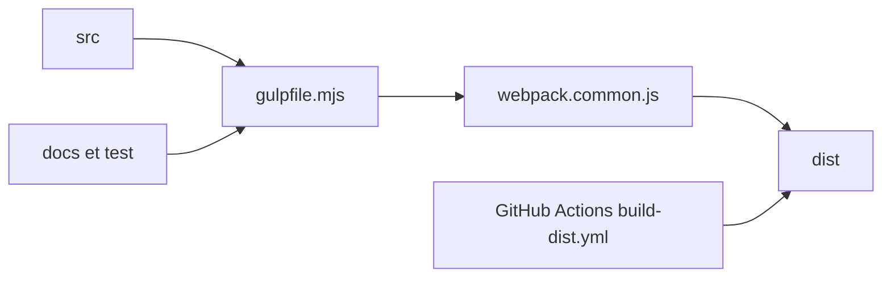

# h5bp/html5-boilerplate

> Front-end starter template for websites and web applications, without imposing a framework.

## The problem
Starting a site with the right base files (HTML, CSS, 404, robots, manifest) means recreating the same structure every time.

## What it actually does
The repository is used to build the template: the deliverable is the `dist/` folder (index.html, 404.html, css/style.css, js/app.js, images, robots.txt, site.webmanifest). It provides utility CSS classes, print styles, Open Graph tags and an example `package.json`. The build uses Gulp and Webpack; CI publishes to npm.

## How it is wired


## Trying it
```bash
npx create-html5-boilerplate new-site
cd new-site
npm install
npm run start
```

## Cost and gotchas
Free. Do not clone this repository to start a site: the README recommends the npx script, the template repository or the npm package.

## What it is not
It is not a framework or a component system.

## Alternatives
No alternative named in the README.

## For you
Ignore: front-end template, unrelated to your data or AI pipelines.
