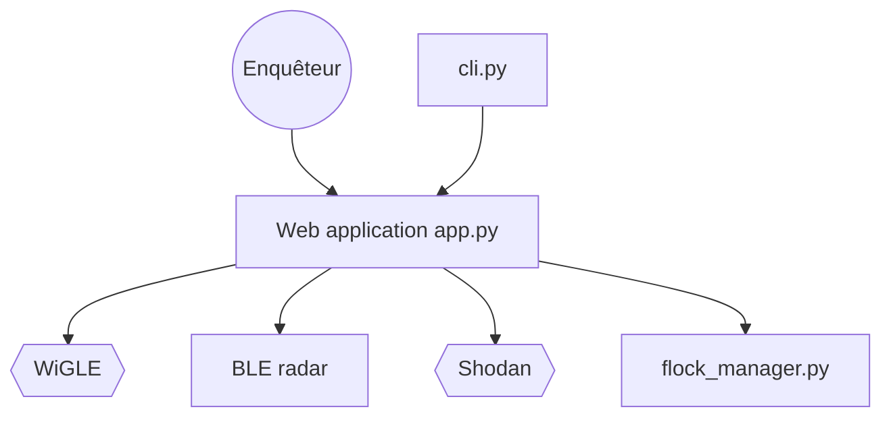

# h9zdev/WireTapper

> Wireless OSINT web application that maps Wi-Fi, Bluetooth and cellular for investigators and security researchers.

## The problem
Knowing which radio devices exist around you and where, without manually assembling several public databases.

## What it actually does
A Flask application, essentially a single app.py. It queries WiGLE for Wi-Fi, scans Bluetooth Low Energy, looks for connected objects via Shodan and Censys, consults OpenCellID for cell towers and geocodes with Nominatim. It imports telemetry and manages license plate reader datasets. The README also announces a search for leaked Wi-Fi passwords using k-anonymity.

## How it is wired


## Trying it
```bash
pip install wiretapper
```
The keys (WIGLE_API_NAME, WIGLE_API_TOKEN, OPENCELLID_API_KEY, SHODAN_API_KEY, CENSYS_API_ID, CENSYS_API_SECRET) are configured as described in the wiki.

## Cost and gotchas
Several third-party accounts and keys, some paid. License present but not identified. Usage must be legally framed: device geolocation and license plate data.

## What it is not
Not an intrusion tool: the README says passive and non-intrusive. AI remains a promise ("soon").

## Alternatives
No alternative named in the README (EthiFi and SocioSential are projects by the same author).

## For you
Ignore: outside your field and legally sensitive; only the method of cross-referencing open sources could inspire a data pipeline.
