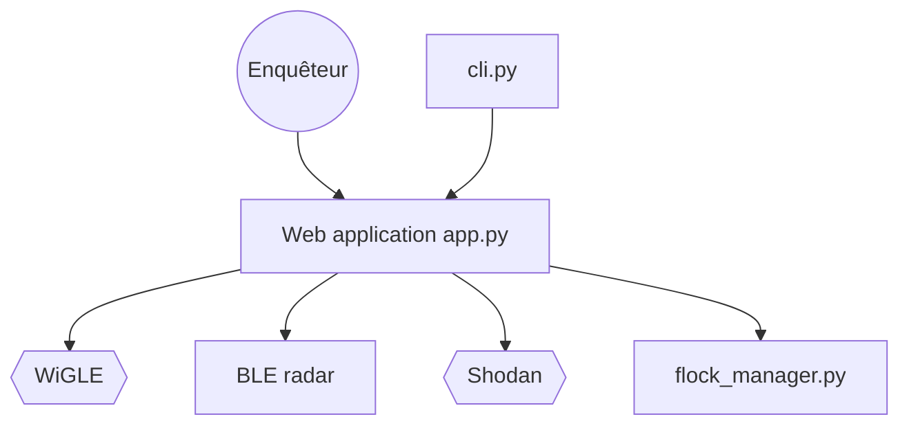

# h9zdev/WireTapper

> Application web d'OSINT sans fil qui cartographie Wi-Fi, Bluetooth et cellulaire pour enquêteurs et chercheurs en sécurité.

## Le problème
Savoir quels appareils radio existent autour de soi et où, sans assembler à la main plusieurs bases publiques.

## Ce que ça fait vraiment
Une application Flask, essentiellement un seul app.py. Elle interroge WiGLE pour le Wi-Fi, scanne le Bluetooth basse consommation, cherche des objets connectés via Shodan et Censys, consulte OpenCellID pour les antennes et géocode avec Nominatim. Elle importe de la télémétrie et gère des jeux de données de lecteurs de plaques. Le README annonce aussi une recherche de mots de passe Wi-Fi fuités par k-anonymat.

## Comment c'est branché


## Essayer
```bash
pip install wiretapper
```
Les clés (WIGLE_API_NAME, WIGLE_API_TOKEN, OPENCELLID_API_KEY, SHODAN_API_KEY, CENSYS_API_ID, CENSYS_API_SECRET) se configurent selon le wiki.

## Coût et pièges
Plusieurs comptes et clés tiers, certains payants. Licence présente mais non identifiée. Usage à encadrer légalement : localisation d'appareils et données de plaques d'immatriculation.

## Ce que ce n'est pas
Pas un outil d'intrusion : le README dit passif et sans intrusion. L'IA reste une promesse ("soon").

## Alternatives
Aucune alternative nommée dans le README (EthiFi et SocioSential sont des projets du même auteur).

## Pour toi
À ignorer : hors de ton champ et juridiquement sensible ; seule la méthode de croisement de sources ouvertes pourrait inspirer un pipeline de données.

