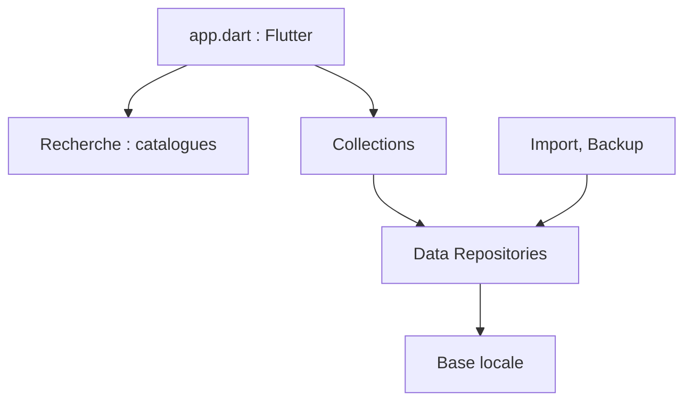

# hacan359/tonkatsu_box

> Local collection manager (games, films, series, books, music) with progress tracking.

## The problem
Trackers for games, series and books are scattered across services that each require an account.

## What it actually does
Flutter application that searches fifteen catalogs (IGDB, TMDB, AniList, MusicBrainz…), tracks status, ratings and episodes, and produces statistics, tier lists and visual boards. It imports from Steam, Trakt, MyAnimeList, Simkl. Data stays on the device; a web version exists via Docker.

## How it is wired


## Trying it
```bash
git clone https://github.com/hacan359/tonkatsu_box.git
cd tonkatsu_box
docker compose up -d --build
# puis ouvrir http://<ip-du-serveur>:8080
```

## Cost and gotchas
Free. The README warns to back up before updating (migrations). Device-to-device sync replaces the whole database, unencrypted; web mode has no default account.

## What it is not
Not a cloud service: no online sync. The macOS version is announced as experimental and untested.

## Alternatives
No alternative named in the README.

## For you
Ignore: a personal media manager, outside your data / AI / MLOps scope.
