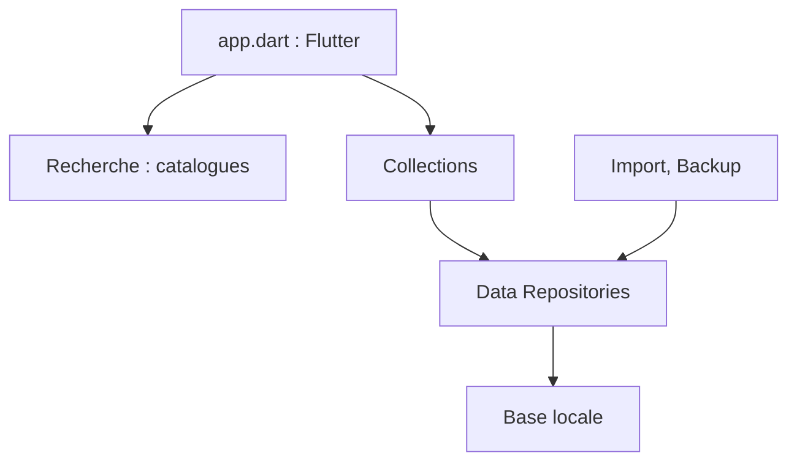

# hacan359/tonkatsu_box

> Gestionnaire local de collections (jeux, films, séries, livres, musique) avec suivi de progression.

## Le problème
Les suivis de jeux, séries et livres sont éparpillés entre services qui exigent chacun un compte.

## Ce que ça fait vraiment
Application Flutter qui cherche dans quinze catalogues (IGDB, TMDB, AniList, MusicBrainz…), suit statut, notes et épisodes, produit des statistiques, des tier lists et des tableaux visuels. Elle importe depuis Steam, Trakt, MyAnimeList, Simkl. Les données restent sur l'appareil ; une version web existe via Docker.

## Comment c'est branché


## Essayer
```bash
git clone https://github.com/hacan359/tonkatsu_box.git
cd tonkatsu_box
docker compose up -d --build
# puis ouvrir http://<ip-du-serveur>:8080
```

## Coût et pièges
Gratuit. Le README avertit de sauvegarder avant mise à jour (migrations). La synchro d'appareil à appareil remplace toute la base, sans chiffrement ; le mode web n'a pas de compte par défaut.

## Ce que ce n'est pas
Pas un service cloud : aucune synchro en ligne. La version macOS est annoncée expérimentale et non testée.

## Alternatives
Aucune alternative nommée dans le README.

## Pour toi
Ignorer : un gestionnaire de médias personnel, hors de ton champ data / IA / MLOps.

