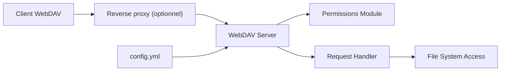

# hacdias/webdav

> Standalone WebDAV server in Go, configurable in YAML, JSON or TOML, to serve folders with per-user permissions.

## The problem
Exposing a folder over WebDAV (backups, synchronization) without setting up a full web server.

## What it actually does
A single binary that reads a configuration file: served directory (one or several), users (plaintext password, bcrypt or environment variable), default and per-user CRUD permissions, rules by path or regex, CORS, direct TLS, console or JSON logs. A fail2ban example is provided.

## How it is wired


## Trying it
```bash
go install github.com/hacdias/webdav/v5@latest
webdav --help
docker run -p 6065:6065 -v ./config.yml:/config.yml:ro -v ./data:/data ghcr.io/hacdias/webdav -c /config.yml
```

## Cost and gotchas
Free. The example configuration contains admin/admin: change it. With no user declared, there is no authentication. Behind a proxy, the Destination header must be rewritten for COPY/MOVE, otherwise 502 errors; under a sub-path, set `prefix`.

## What it is not
Not a file-sharing platform with a web interface: it is a protocol server. No account management other than the configuration file.

## Alternatives
No alternative named in the README (Caddy, Nginx, Apache appear there only as proxies).

## For you
Adopt if you need lightweight WebDAV sharing (backups, notes, artifacts): one binary, one config, fine-grained permissions.
