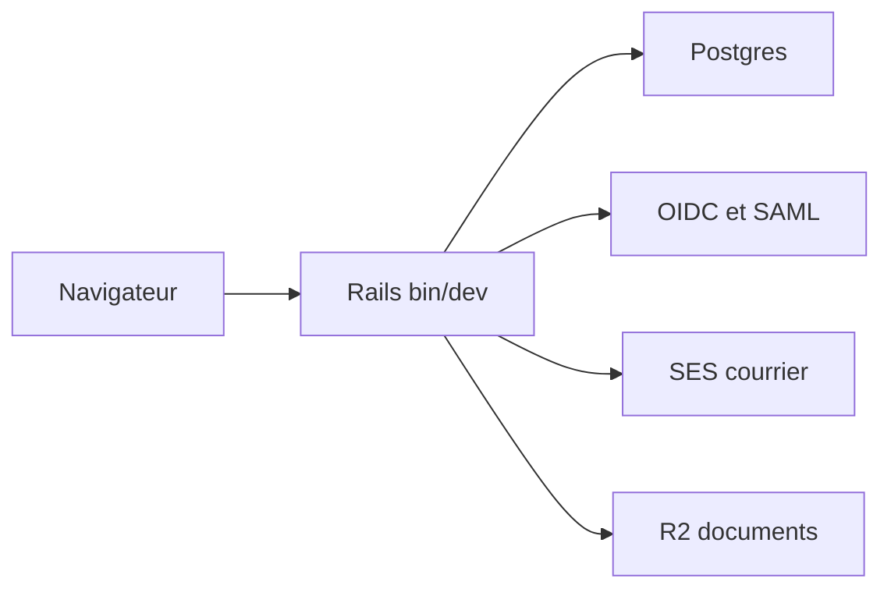

# hackclub/auth

> Rails application that provides Hack Club's authentication and identity, published as a code reference.

## The problem
Providing a single identity to a community requires SSO, OIDC, SAML and protection of sensitive data.

## What it actually does
Rails app with Postgres: login with an emailed code and TOTP two-factor authentication, OIDC and SAML provider, encrypted fields (Lockbox, Active Record Encryption), an admin area. In production: SES for mail, Cloudflare R2 for documents, Sentry, Google Places.

## How it is wired
Simplified diagram based on the sheet, no diagram provided.



## Trying it
```bash
docker compose -f docker-compose-dbonly.yml up -d
bundle install
yarn install
bin/rails db:prepare
bin/rails db:seed
bin/dev
```

## Cost and gotchas
Ruby 3.4.4, Node, Yarn, Postgres, ImageMagick, libvips and libxmlsec1: none of them is in the list, hence `none`, but Docker for the database. Production: AWS SES and Cloudflare R2 accounts, keys to generate.

## What it is not
It is not a reusable authentication building block: it is Hack Club's own app, with no declared license.

## Alternatives
No alternative named in the README.

## For you
Ignore: without a license you cannot reuse it, and it is tailored to a single organization.
