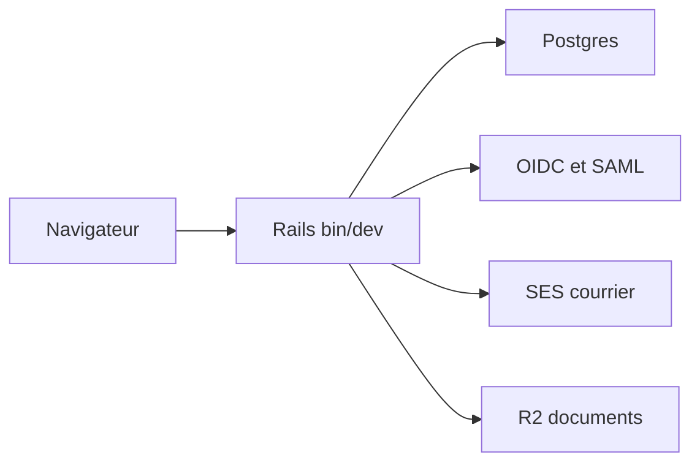

# hackclub/auth

> Application Rails qui fournit l'authentification et l'identité de Hack Club, publiée comme référence de code.

## Le problème
Fournir une identité unique à une communauté demande SSO, OIDC, SAML et protection de données sensibles.

## Ce que ça fait vraiment
Appli Rails avec Postgres : connexion avec code par mail et double authentification TOTP, fournisseur OIDC et SAML, champs chiffrés (Lockbox, Active Record Encryption), espace d'administration. En production : SES pour le courrier, Cloudflare R2 pour les documents, Sentry, Google Places.

## Comment c'est branché
Schéma simplifié d'après la fiche, sans diagramme fourni.



## Essayer
```bash
docker compose -f docker-compose-dbonly.yml up -d
bundle install
yarn install
bin/rails db:prepare
bin/rails db:seed
bin/dev
```

## Coût et pièges
Ruby 3.4.4, Node, Yarn, Postgres, ImageMagick, libvips et libxmlsec1 : aucun n'est dans la liste, d'où `aucun` mais Docker pour la base. Production : comptes AWS SES et Cloudflare R2, clés à générer.

## Ce que ce n'est pas
Ce n'est pas une brique d'authentification réutilisable : c'est l'appli propre à Hack Club, sans licence déclarée.

## Alternatives
Aucune alternative nommée dans le README.

## Pour toi
Ignorer : sans licence tu ne peux pas la reprendre, et elle est taillée pour un seul organisme.

