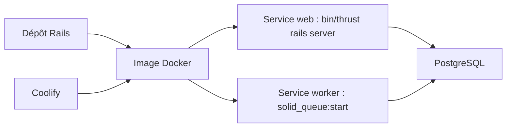

# hackclub/flavortown

> Code of Hack Club's "Flavortown" Rails application, which can be run locally with Docker.

## The problem
The README does not say what the application is for: only the getting-started steps for contributing are given.

## What it actually does
Undocumented: its functional purpose is not described. The README only details the local setup (database, Rails via `bin/dev`) and a production deployment on Coolify with two services, web and worker, on the same Docker image. The worker runs `solid_queue:start`. A CONTRIBUTING.md file is mentioned.

## How it is wired


## Trying it
```bash
docker compose up -d db
docker compose run --service-ports web /bin/bash
bin/dev
docker compose run web bin/rails db:migrate
bin/rails db:prepare
```

## Cost and gotchas
Free locally. The license is missing: with no declared license, nothing allows reuse. On Windows, "file not found" errors come from line endings; the suggested fix (`git reset --hard`) wipes the local code.

## What it is not
It is not a library or a reusable tool: it is the code of a specific Hack Club service. The README describes no functions or usage.

## Alternatives
No alternative named in the README.

## For you
Ignore: no license, no product description, and no visible link with a data, AI or MLOps profile.
