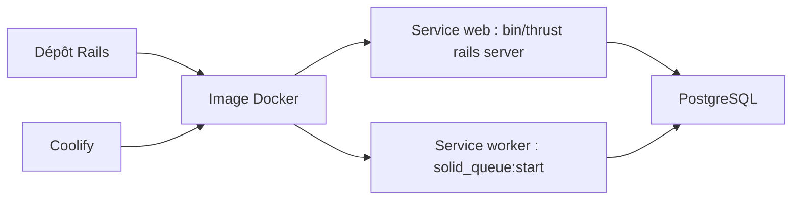

# hackclub/flavortown

> Code de l'application Rails de Hack Club « Flavortown », que l'on peut lancer en local avec Docker.

## Le problème
Le README ne dit pas à quoi sert l'application : seule la mise en route pour contribuer y figure.

## Ce que ça fait vraiment
Non documenté : la finalité fonctionnelle n'est pas décrite. Le README détaille uniquement l'installation en local (base de données, Rails via `bin/dev`) et un déploiement en production sur Coolify avec deux services, web et worker, sur la même image Docker. Le worker lance `solid_queue:start`. Un fichier CONTRIBUTING.md est mentionné.

## Comment c'est branché


## Essayer
```bash
docker compose up -d db
docker compose run --service-ports web /bin/bash
bin/dev
docker compose run web bin/rails db:migrate
bin/rails db:prepare
```

## Coût et pièges
Gratuit en local. La licence est absente : sans licence déclarée, rien n'autorise la réutilisation. Sous Windows, des erreurs « file not found » viennent des fins de ligne ; la parade proposée (`git reset --hard`) efface le code local.

## Ce que ce n'est pas
Ce n'est pas une bibliothèque ni un outil réutilisable : c'est le code d'un service précis de Hack Club. Le README ne décrit ni fonctions ni usage.

## Alternatives
Aucune alternative nommée dans le README.

## Pour toi
À ignorer : pas de licence, pas de description du produit et aucun lien visible avec un profil data, IA ou MLOps.

