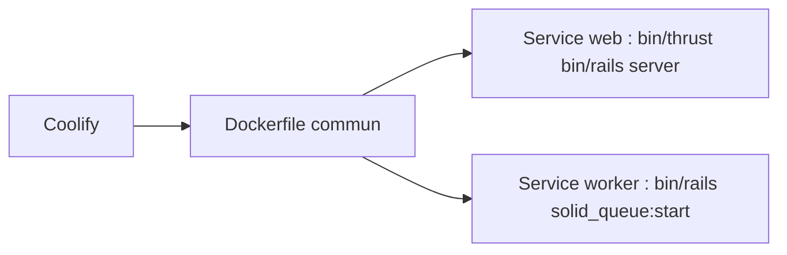

# hackclub/stardance

> Hack Club web application ("spaceport"), deployed on Coolify; deployment-only README.

## The problem
Undocumented: the README does not say what the application does.

## What it actually does
The README announces "what's launching on the hack club spaceport" and describes the deployment: a web service (`./bin/thrust ./bin/rails server`) and a worker service (`./bin/rails solid_queue:start`), built with the same Dockerfile. It looks like a Rails app, but the README does not say so.

## How it is wired
Simplified diagram based on the sheet, no diagram provided.


## Trying it
```bash
./bin/thrust ./bin/rails server
./bin/rails solid_queue:start
```

## Cost and gotchas
Free. No license declared: reuse rights unknown. Development points to `CONTRIBUTING.md`, which was not provided.

## What it is not
Not a reusable tool: it is the code of one specific site. No explanation of its role.

## Alternatives
None named in the README.

## For you
Ignore: internal application of a community with no license or description, no link to data / AI work.
