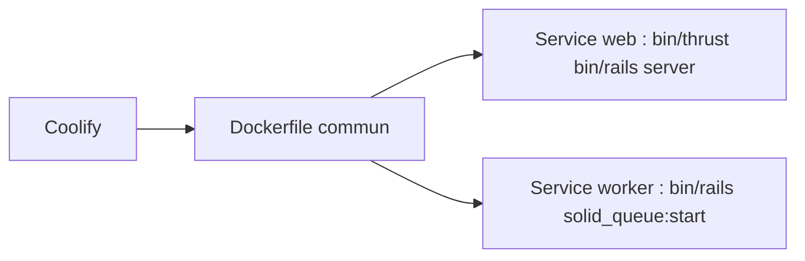

# hackclub/stardance

> Application web de Hack Club (« spaceport »), déployée sur Coolify ; README de déploiement seulement.

## Le problème
Non documenté : le README ne dit pas ce que fait l'application.

## Ce que ça fait vraiment
Le README annonce « what's launching on the hack club spaceport » et décrit le déploiement : un service web (`./bin/thrust ./bin/rails server`) et un service worker (`./bin/rails solid_queue:start`), construits avec le même Dockerfile. Ça ressemble à une appli Rails, mais le README ne le dit pas.

## Comment c'est branché
Schéma simplifié d'après la fiche, sans diagramme fourni.


## Essayer
```bash
./bin/thrust ./bin/rails server
./bin/rails solid_queue:start
```

## Coût et pièges
Gratuit. Aucune licence déclarée : droits de réutilisation inconnus. Le développement renvoie à `CONTRIBUTING.md`, non fourni.

## Ce que ce n'est pas
Pas un outil réutilisable : c'est le code d'un site précis. Pas d'explication de son rôle.

## Alternatives
Aucune nommée dans le README.

## Pour toi
Ignorer : application interne d'une communauté sans licence ni description, aucun lien avec un travail data / IA.

