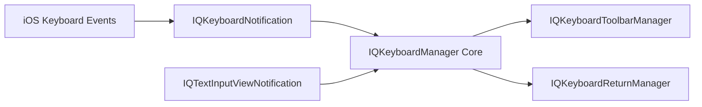

# hackiftekhar/IQKeyboardManager

> iOS library that keeps the keyboard from hiding input fields, for iPhone app developers.

## The problem
On iOS, the keyboard often covers a `UITextField` or `UITextView` and you have to write scrolling code by hand.

## What it actually does
The Swift module automatically moves the view up when the keyboard appears, and handles scroll views, tables and collections, in all orientations. Optional (subspecs): Previous/Next/Done toolbar, return key handling, resign on touch, keyboard appearance, `UITextView` with placeholder. The Objective-C version has moved to another repository.

## How it is wired


## Trying it
```bash
pod 'IQKeyboardManagerSwift'
```
```swift
IQKeyboardManager.shared.isEnabled = true
```

## Cost and gotchas
iOS 13+, Xcode 13+. Installation from source code has no longer been supported since 7.2.0. Do not embed it in a third-party library (warning from the author).

## What it is not
Not a library for SDKs: the author advises against shipping it as a dependency. Not cross-platform code.

## Alternatives
No alternative named in the README.

## For you
Ignore: an iOS development tool unrelated to a data/AI/MLOps profile, despite its quality.
