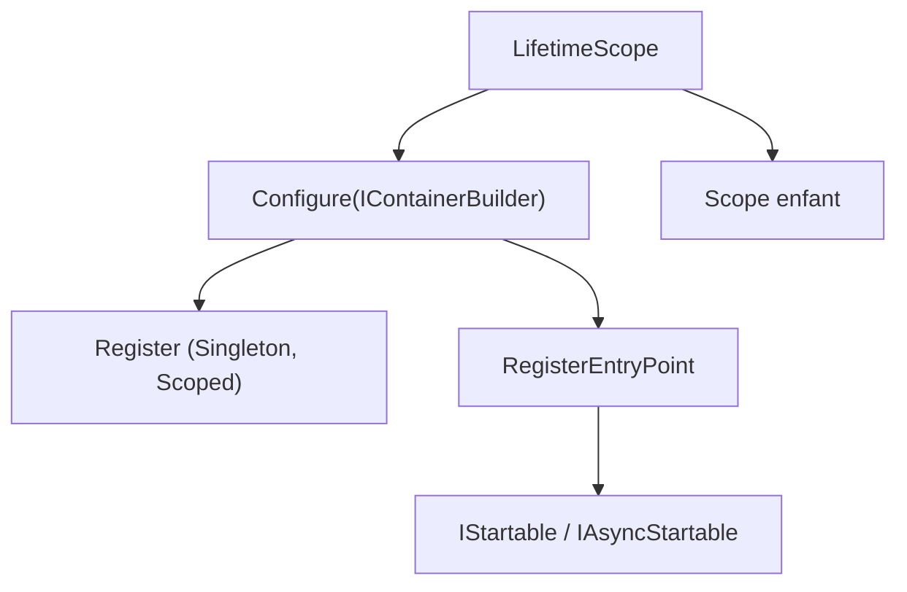

# hadashiA/VContainer

> Fast dependency injection library for the Unity game engine.

## The problem
The dependency graphs of a Unity game become hard to manage, and Zenject allocates memory and slows things down.

## What it actually does
An immutable container with constructor, method, property and field injection. Nested `LifetimeScope`s, created on demand, including asynchronously. Pure C# entry points hooked into its own player loop, a diagnostics window, UniTask integration, ECS in beta. Claims to be 5 to 10 times faster than Zenject.

## How it is wired
Simplified diagram based on the sheet, no diagram provided.



## Trying it
```bash
openupm add jp.hadashikick.vcontainer
```

## Cost and gotchas
Free, Unity 2018.4 or later. The code-generator-accelerated mode is optional. The gain over Zenject is a claim from the README.

## What it is not
Not a complete game framework: dependency injection only. Pointless outside Unity.

## Alternatives
Zenject and Extenject, cited as a source of inspiration.

## For you
Ignore: reserved for Unity developers, of no use for a data, AI or MLOps profile.
