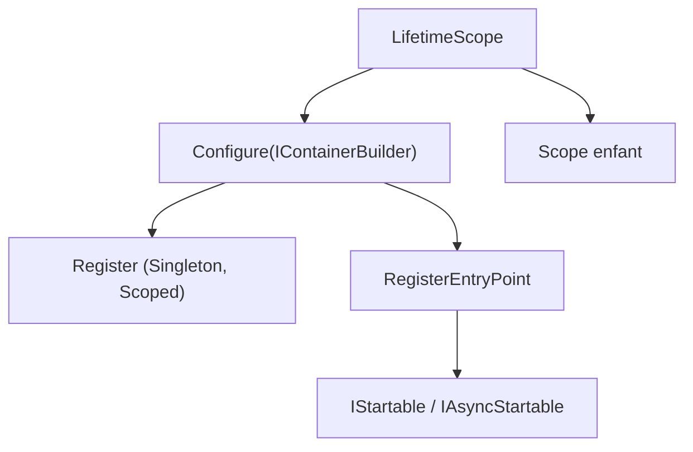

# hadashiA/VContainer

> Bibliothèque d'injection de dépendances rapide pour le moteur de jeu Unity.

## Le problème
Les graphes de dépendances d'un jeu Unity deviennent difficiles à gérer, et Zenject alloue et ralentit.

## Ce que ça fait vraiment
Un conteneur immuable avec injection par constructeur, méthode, propriété et champ. Des `LifetimeScope` imbriqués, créés à la demande, y compris en asynchrone. Des points d'entrée en C# pur branchés sur sa propre boucle de joueur, une fenêtre de diagnostic, une intégration UniTask, ECS en bêta. Annonce 5 à 10 fois plus rapide que Zenject.

## Comment c'est branché
Schéma simplifié d'après la fiche, sans diagramme fourni.



## Essayer
```bash
openupm add jp.hadashikick.vcontainer
```

## Coût et pièges
Gratuit, Unity 2018.4 ou plus. Le mode accéléré par générateur de code est optionnel. Le gain face à Zenject est une annonce du README.

## Ce que ce n'est pas
Pas un cadre de jeu complet : uniquement l'injection de dépendances. Sans objet hors Unity.

## Alternatives
Zenject et Extenject, cités comme source d'inspiration.

## Pour toi
À ignorer : réservé aux développeurs Unity, sans usage pour un profil data, IA ou MLOps.

