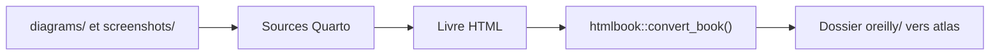

# hadley/r4ds

> Sources of the book "R for Data Science", built with Quarto, for learning data analysis in R.

## The problem
Learning to import, transform and visualize data in R with a coherent reference guide.

## What it actually does
The repository contains the text of the book, built with Quarto. The README only describes production instructions: exporting Omnigraffle diagrams at 300 dpi, screenshots, generating the HTML files for O'Reilly with `htmlbook`. The teaching content itself is not described here.

## How it is wired


## Trying it
```r
# pak::pak("hadley/htmlbook")
htmlbook::convert_book()
```
The README documents no reading command: it is a guide to producing the book.

## Cost and gotchas
Free. Building the book requires R, Quarto and the author's publishing tools. License present but not identified by GitHub.

## What it is not
Not an interactive online course here: it is the book's source code. The README is very short.

## Alternatives
None cited in the README.

## For you
Adopt: recognized reference for data analysis in R, active repository in October 2026; read it for the method, not for the README.
