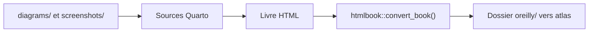

# hadley/r4ds

> Sources du livre « R for Data Science », construit avec Quarto, pour apprendre l'analyse de données en R.

## Le problème
Apprendre à importer, transformer et visualiser des données en R avec un guide de référence suivi.

## Ce que ça fait vraiment
Le dépôt contient le texte du livre, construit avec Quarto. Le README ne décrit que les consignes de fabrication : export des schémas Omnigraffle à 300 dpi, captures d'écran, génération des fichiers HTML pour O'Reilly avec `htmlbook`. Le contenu pédagogique lui-même n'est pas décrit ici.

## Comment c'est branché


## Essayer
```r
# pak::pak("hadley/htmlbook")
htmlbook::convert_book()
```
Le README ne documente pas de commande de lecture : c'est un guide de production du livre.

## Coût et pièges
Gratuit. Construire le livre suppose R, Quarto et les outils d'édition de l'auteur. Licence présente mais non identifiée par GitHub.

## Ce que ce n'est pas
Pas un cours en ligne interactif ici : c'est le code source du livre. Le README est très court.

## Alternatives
Aucune citée dans le README.

## Pour toi
Adopter : référence reconnue pour l'analyse de données en R, dépôt actif en octobre 2026 ; à lire pour la méthode, pas pour le README.

