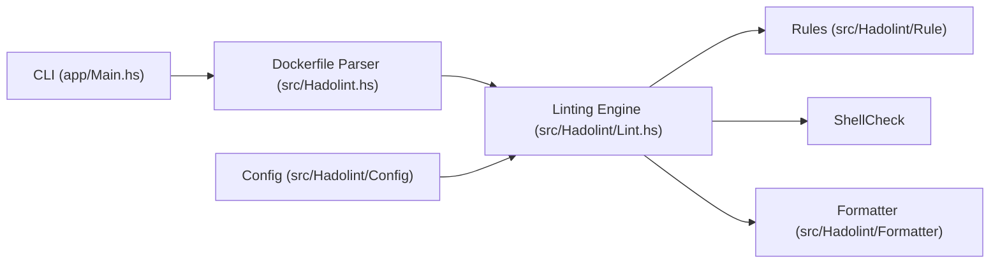

# hadolint/hadolint

> Dockerfile linter in Haskell that enforces best practices and relies on ShellCheck.

## The problem
A badly written Dockerfile produces heavy, non-reproducible or unsafe images, with no warning from the build.

## What it actually does
It parses the Dockerfile into an AST (language-docker library), applies hadolint's own `DL…` rules and ShellCheck's `SC…` rules on `RUN` instructions. Outputs in tty, JSON, SARIF, JUnit, etc. Configuration through `.hadolint.yaml` or environment variables, inline or global ignores, label schema, trusted registries.

## How it is wired


## Trying it
```bash
hadolint Dockerfile
hadolint --ignore DL3003 --ignore DL3006 Dockerfile
docker run --rm -i hadolint/hadolint < Dockerfile
brew install hadolint
hadolint --config /path/to/config.yaml Dockerfile
```

## Cost and gotchas
Free. The base Docker image has no shell: use the Debian or Alpine variants if needed. Without configuration, its warnings can block a CI: set `failure-threshold`.

## What it is not
Not an image vulnerability scanner. It analyzes the file, not the built image.

## Alternatives
- replicatedhq/dockerfilelint: the other linter in super-linter.
- RedCoolBeans/dockerlint
- projectatomic/dockerfile_lint

## For you
Adopt: a CI step that costs almost nothing and makes your training and serving images cleaner.
