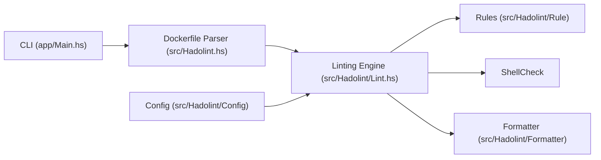

# hadolint/hadolint

> Linter de Dockerfile en Haskell qui applique les bonnes pratiques et s'appuie sur ShellCheck.

## Le problème
Un Dockerfile mal écrit donne des images lourdes, non reproductibles ou peu sûres, sans alerte du build.

## Ce que ça fait vraiment
Il parse le Dockerfile en AST (bibliothèque language-docker), applique des règles `DL…` propres à hadolint et les règles `SC…` de ShellCheck sur les instructions `RUN`. Sorties en tty, JSON, SARIF, JUnit, etc. Configuration par `.hadolint.yaml` ou variables d'environnement, ignores en ligne ou globaux, schéma de labels, registres de confiance.

## Comment c'est branché


## Essayer
```bash
hadolint Dockerfile
hadolint --ignore DL3003 --ignore DL3006 Dockerfile
docker run --rm -i hadolint/hadolint < Dockerfile
brew install hadolint
hadolint --config /path/to/config.yaml Dockerfile
```

## Coût et pièges
Gratuit. Image Docker de base sans shell : prendre les variantes Debian ou Alpine si besoin. Sans configuration, ses alertes peuvent bloquer un CI : régler `failure-threshold`.

## Ce que ce n'est pas
Pas un scanner de vulnérabilités d'images. Il analyse le fichier, pas l'image construite.

## Alternatives
- replicatedhq/dockerfilelint : l'autre linter du super-linter.
- RedCoolBeans/dockerlint
- projectatomic/dockerfile_lint

## Pour toi
À adopter : une étape de CI qui coûte presque rien et rend tes images d'entraînement et de service plus propres.

