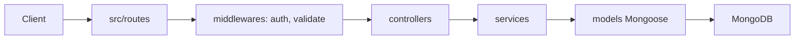

# hagopj13/node-express-boilerplate

> Node/Express/Mongoose REST API template with JWT authentication, validation, tests and Docker.

## The problem
Starting a clean REST API means rewiring auth, validation, logging and tests every time.

## What it actually does
Generates a project via `npx create-nodejs-express-app`. Includes passport/JWT, Joi, Winston/Morgan, Jest, Swagger, PM2, helmet, Docker, ESLint/Prettier. Routes, controllers, services and Mongoose model layers with `toJSON` and `paginate` plugins.

## How it is wired


## Trying it
```bash
npx create-nodejs-express-app <project-name>
yarn install
cp .env.example .env
yarn dev
yarn test
```

## Cost and gotchas
Free; MongoDB and an SMTP server required. Last push in July 2024, Travis CI: dependencies probably need updating. The example JWT secret must be changed.

## What it is not
Not "production ready" without a dependency audit and updates.

## Alternatives
Cited inspirations: danielfsousa/express-rest-es2017-boilerplate, madhums/node-express-mongoose, kunalkapadia/express-mongoose-es6-rest-api.

## For you
Ignore: a general-purpose web template, aging and unrelated to data/AI/MLOps.
