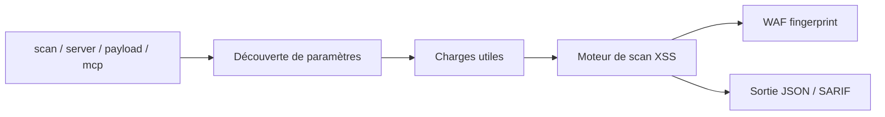

# hahwul/dalfox

> Command-line XSS scanner (rewritten in Rust in v3) for testing web parameters.

## The problem
Finding the XSS injection points of a web application by hand is slow and repetitive.

## What it actually does
Subcommands `scan` (URL, file, pipe or raw request), `server` (REST API), `payload` and `mcp` (stdio server). Parameter analysis, static search, reflected, stored and DOM XSS with verification, WAF detection with a score, custom headers and cookies, JSON, SARIF, Markdown and TOML outputs. Custom or remote payloads.

## How it is wired


## Trying it
```bash
brew install dalfox
dalfox scan http://example.com -b https://callback
cat urls.txt | dalfox scan --headers "AuthToken: xxx"
dalfox scan 'https://example.com/?q=FUZZ&page=1' --inject-marker FUZZ
```

## Cost and gotchas
Free. The architecture diagram describes a Go tree (cmd/, pkg/) while the README announces a Rust rewrite: it is outdated, the Go branches remain under `v2`. Use only on authorized targets.

## What it is not
Not a general-purpose vulnerability scanner: it targets XSS. Not proof that no flaw exists.

## Alternatives
No alternative named in the README.

## For you
Worth watching: useful for testing your own web interfaces (dashboards, APIs), without directly concerning data or AI.
