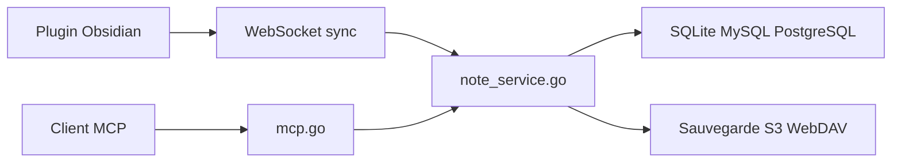

# haierkeys/fast-note-sync-service

> Self-hosted Go server that syncs Obsidian vaults, with a REST API and an MCP server for AI agents.

## The problem
Sync Obsidian notes across devices without a third-party service, while letting an AI assistant read and write them.

## What it actually does
A Go server (WebSocket + protobuf for real-time sync, REST, React admin panel) manages vaults, notes, history, trash, sharing, chunked attachments, S3/OSS/R2/WebDAV backups and Git push. It also exposes MCP tools (Streamable HTTP and SSE). Databases: SQLite, MySQL or PostgreSQL. An Obsidian client plugin is required.

## How it is wired


## Trying it
```bash
docker pull haierkeys/fast-note-sync-service:latest
docker compose up -d
./fast-note-sync-service run -c config/config.yaml
```

## Cost and gotchas
Free; hosting is on you. The install script is a `curl | bash`. The README does not show the Apache-2.0 license but the catalog does.

## What it is not
Not an Obsidian client: without the plugin, no data. Not an AI knowledge base in itself.

## Alternatives
The README cites third-party clients: FastNodeSync-CLI, go-fast-note-sync, Fast-note-sync-docker.

## For you
Keep an eye on it: an MCP server giving an agent access to your notes is a concrete use case, but 166 open issues and a single maintainer.
