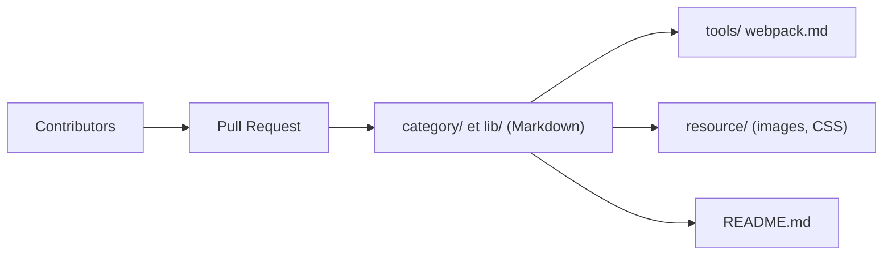

# haizlin/fe-interview

> Bank of over 6000 front-end interview questions in Chinese, with one question per day.

## The problem
Preparing for front-end interviews requires a broad corpus of questions, organized by topic and regularly updated.

## What it actually does
Repository of Markdown files sorted by category (HTML, CSS, JS, soft skills) and by framework (Vue, React, AngularJs, Node, jQuery, mini-programs), plus webpack. The README announces a new question every day (2386 days elapsed as of 2025-10-27) and a contribution system by pull request. No application code: content only.

## How it is wired

## Trying it
No command: you read the README and the question folders, or open a pull request to propose one.

## Cost and gotchas
Free. Written in Chinese. At the top of the README, a promotion for a badminton app ("soon open source"). The repository has 6,259 open issues. Last push on 2025-10-26, at the one-year limit.

## What it is not
Not a course with answers: the questions are there for the reader to answer. The site generator suggested by the architecture is an assumption of the diagram, not documented.

## Alternatives
- No alternative named in the README.

## For you
Ignore: front-end interview preparation in Chinese, of no interest for a data/AI profile.
