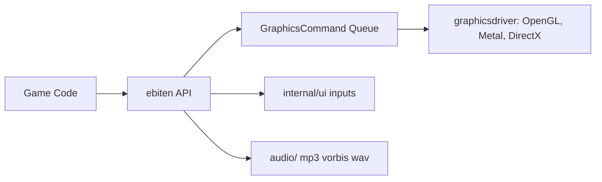

# hajimehoshi/ebiten

> A simple 2D game engine for Go, cross-platform, for game developers.

## The problem
Writing a portable 2D game in Go without going through C or heavy engines.

## What it actually does
Update/Draw loop API. 2D graphics (matrices, shaders, offscreen rendering, automatic atlas), inputs (mouse, keyboard, gamepads, touch), Ogg/Vorbis, MP3 and WAV audio. DirectX, Metal and OpenGL graphics drivers. Targets Windows, macOS, Linux, FreeBSD, Android, iOS, WebAssembly, Switch and Xbox (Cgo required on some).

## How it is wired

## Trying it
No command in the README: it points to the ebitengine.org website and the installation page.

## Cost and gotchas
Free. Cgo is required for Android, iOS, Switch and Xbox. Xbox support is limited. 289 open issues.

## What it is not
Not a 3D engine or a visual editor: it is a code library.

## Alternatives
No alternative mentioned in the README.

## For you
Ignore: a 2D game engine unrelated to data/AI/MLOps, to keep in mind only for interactive visualizations in Go.
