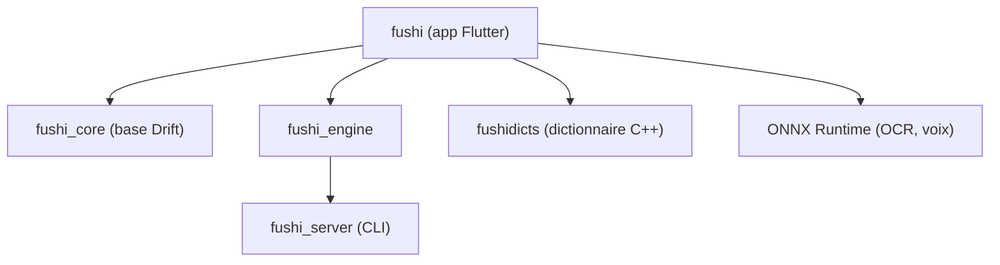

# hajisensai/Fushi

> Cross-platform app for reading and learning Japanese: books, manga, video, dictionaries and Anki cards.

## The problem
Learning a language by immersion requires separate tools to read, watch, look up words and create cards.

## What it actually does
Flutter app for Android, Windows, macOS, iOS and Linux, with a lightweight server. EPUB reader, video (libmpv), C++ dictionary, card creation via AnkiDroid or AnkiConnect, cloud or P2P sync, and on-device speech recognition and manga OCR through ONNX Runtime.

## How it is wired
Simplified diagram based on the sheet, no diagram provided.


## Trying it
```bash
bash tool/bootstrap.sh
cd fushi
flutter build apk --release --target-platform android-arm64 --split-per-abi
dart build cli
```
Ready-to-use versions can be downloaded from the project's website.

## Cost and gotchas
Free. Flutter 3.47.6 required to build. Daily telemetry (hashed install identifier, version, platform) is active on desktop and Android, and can be disabled. The optional Google Lens OCR sends pages to Google.

## What it is not
Not an MLOps tool: AI is used here for language learning. No Intel version for macOS.

## Alternatives
No alternative cited in the README (jidoujisho, Hoshi Reader and Yomitan are cited as inspirations).

## For you
Ignore: Japanese-learning app, unrelated to your work; only its on-device use of ONNX may be of interest.
