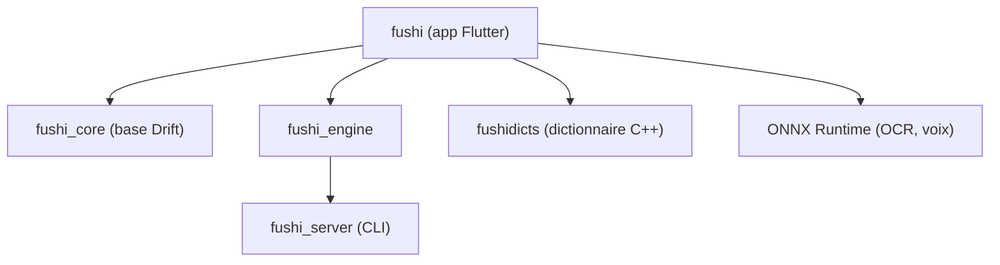

# hajisensai/Fushi

> Application multiplateforme de lecture et d'apprentissage du japonais : livres, manga, vidéo, dictionnaires et cartes Anki.

## Le problème
Apprendre une langue par immersion demande des outils séparés pour lire, regarder, chercher les mots et créer des cartes.

## Ce que ça fait vraiment
Application Flutter pour Android, Windows, macOS, iOS et Linux, avec un serveur léger. Lecteur d'EPUB, vidéo (libmpv), dictionnaire en C++, création de cartes via AnkiDroid ou AnkiConnect, synchronisation cloud ou P2P, et reconnaissance vocale et OCR de manga par ONNX Runtime, sur l'appareil.

## Comment c'est branché
Schéma simplifié d'après la fiche, sans diagramme fourni.


## Essayer
```bash
bash tool/bootstrap.sh
cd fushi
flutter build apk --release --target-platform android-arm64 --split-per-abi
dart build cli
```
Les versions prêtes à l'emploi sont téléchargeables sur le site du projet.

## Coût et pièges
Gratuit. Flutter 3.47.6 exigé pour compiler. Une télémétrie quotidienne (identifiant d'installation haché, version, plateforme) est active sur desktop et Android, désactivable. L'OCR Google Lens est optionnel et envoie les pages à Google.

## Ce que ce n'est pas
Pas un outil de MLOps : l'IA y sert à l'apprentissage des langues. Pas de version Intel pour macOS.

## Alternatives
Aucune alternative citée dans le README (jidoujisho, Hoshi Reader et Yomitan sont cités comme inspirations).

## Pour toi
Ignorer : application d'apprentissage du japonais, sans lien avec le métier ; seul son usage d'ONNX sur l'appareil peut intéresser.

