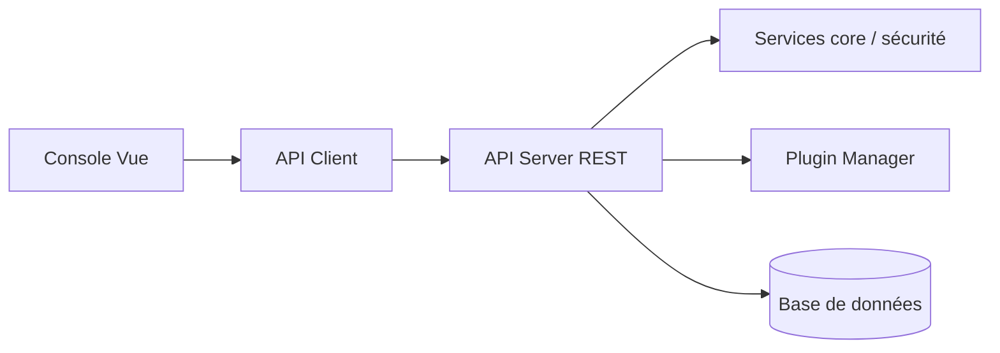

# halo-dev/halo

> A Java site-building tool (blog, knowledge base, showcase site, shop) with themes and plugins.

## The problem
Setting up a self-hosted content site without coding your own stack.

## What it actually does
Java backend (Spring WebFlux judging from the architecture) with an extension and plugin system, a Vue admin console, a dedicated API client, and themes. Three editions are described: community (GPL-3.0, free), professional and shop (paid offerings). Over 100 free themes and plugins.

## How it is wired


## Trying it
```bash
docker run -d --name halo -p 8090:8090 -v ~/.halo2:/root/.halo2 halohub/halo:2.27
```
The README states this is for testing; the recommended deployment goes through the 1Panel panel.

## Cost and gotchas
Free in the community edition; mobile, AI and shop features are reserved for paid editions. README is in Chinese.

## What it is not
Not a code-oriented technical documentation tool. The public demo account mentioned is meant for trials.

## Alternatives
No alternative named in the README.

## For you
Ignore: a blogging platform, outside the data/AI scope, except to host a personal site.
