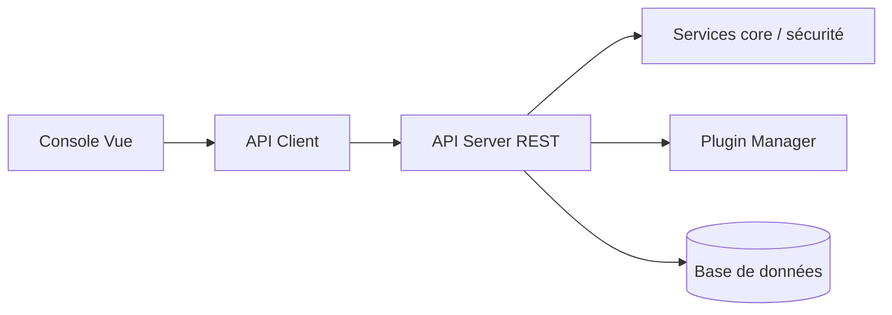

# halo-dev/halo

> Outil de création de sites (blog, base de connaissances, vitrine, boutique), en Java, avec thèmes et plugins.

## Le problème
Monter un site de contenu auto-hébergé sans coder sa pile.

## Ce que ça fait vraiment
Backend Java (Spring WebFlux d'après l'architecture) avec système d'extensions et de plugins, console d'administration Vue, client API dédié, thèmes. Trois éditions décrites : communauté (GPL-3.0, gratuite), professionnelle et boutique (offres payantes). Plus de 100 thèmes et plugins gratuits.

## Comment c'est branché


## Essayer
```bash
docker run -d --name halo -p 8090:8090 -v ~/.halo2:/root/.halo2 halohub/halo:2.27
```
Le README précise que c'est pour test ; le déploiement recommandé passe par le panneau 1Panel.

## Coût et pièges
Gratuit en édition communauté ; fonctions mobiles, IA et boutique réservées aux éditions payantes. README en chinois.

## Ce que ce n'est pas
Pas un outil de documentation technique orienté code. Le compte démo public indiqué est destiné aux essais.

## Alternatives
Aucune alternative nommée dans le README.

## Pour toi
Ignorer : plateforme de blog, hors périmètre data/IA, sauf pour héberger un site personnel.

