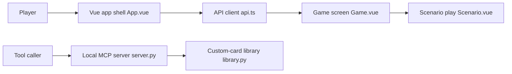

# halogenandtoast/ArkhamHorror

> Web version of the Arkham Horror LCG card game, playable by up to four players.

## The problem
Playing the cooperative card game online, with campaigns and deck import, without a physical board.

## What it actually does
Web application (Vue frontend, Haskell backend, Postgres database) that implements the rules of many campaigns and scenarios, multiplayer, multi-deck solo mode, tarot readings and import from ArkhamDB. A Python MCP server is used to create custom cards. The images (about 2.9 GB) come from a CDN by default.

## How it is wired


## Trying it
```
curl -fsSL https://raw.githubusercontent.com/halogenandtoast/ArkhamHorror/main/install.sh | bash
# puis ouvrir http://localhost:3000
```

## Cost and gotchas
Docker required. The README warns that the project is under development and may break. No license declared and the content is protected by Fantasy Flight Games: unaffiliated fan project.

## What it is not
Not an official game. The backend (game engine) is not visible in the sampled architecture.

## Alternatives
The README does not name an alternative.

## For you
Ignore: hobby game with no clear license, unrelated to data or AI.
