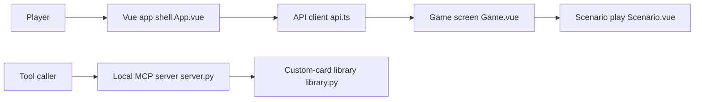

# halogenandtoast/ArkhamHorror

> Version web du jeu de cartes Arkham Horror LCG, jouable jusqu'à quatre joueurs.

## Le problème
Jouer au jeu de cartes coopératif en ligne, avec campagnes et import de decks, sans plateau physique.

## Ce que ça fait vraiment
Application web (frontend Vue, backend Haskell, base Postgres) qui implémente les règles de nombreuses campagnes et scénarios, le multijoueur, le mode solitaire multi-decks, les lectures de tarot et l'import depuis ArkhamDB. Un serveur MCP Python sert à créer des cartes personnalisées. Les images (environ 2,9 Go) viennent d'un CDN par défaut.

## Comment c'est branché


## Essayer
```
curl -fsSL https://raw.githubusercontent.com/halogenandtoast/ArkhamHorror/main/install.sh | bash
# puis ouvrir http://localhost:3000
```

## Coût et pièges
Docker requis. Le README prévient que le projet est en cours de développement et peut casser. Aucune licence déclarée et contenu protégé par Fantasy Flight Games : projet de fans non affilié.

## Ce que ce n'est pas
Pas un jeu officiel. Le backend (moteur de jeu) n'est pas visible dans l'architecture échantillonnée.

## Alternatives
Le README ne nomme pas d'alternative.

## Pour toi
Ignorer : jeu de loisir sans licence claire, sans lien avec la data ou l'IA.

