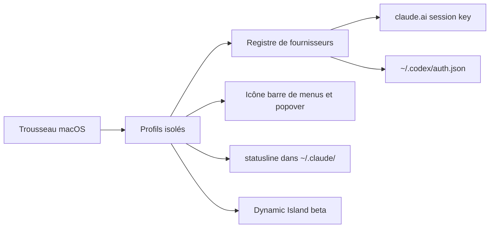

# hamed-elfayome/Claude-Usage-Tracker

> macOS menu bar application that tracks the consumption of your Claude accounts in real time.

## The problem
You don't know where you stand on your five-hour window or your weekly limit until you hit it.
With several accounts, it's worse.

## What it actually does
Tracks session, weekly, per-model (Fable, Opus, Sonnet, Design), API console usage and costs, per profile.
Unlimited profiles with credentials isolated in the macOS keychain, and automatic switching when the cap is reached.
Claude Code integration: CLI account synchronisation, `claude-<profile>` launchers with their own `CLAUDE_CONFIG_DIR`.
Since v3.3.0, profiles can also track OpenAI Codex, on an extensible registry architecture.

## How it is wired


## Trying it
```bash
brew install --cask hamed-elfayome/claude-usage/claude-usage-tracker
```

## Cost and gotchas
macOS 14 (Sonoma) minimum: nothing for Linux or Windows.
Manual mode requires extracting the `sessionKey` cookie from the browser; an anonymous version signal is sent every 24 h.

## What it is not
Not a spending-control tool: it observes, it limits nothing.
Not an official Anthropic product, despite the depth of the Claude Code integration.
The Dynamic Island is in beta and reads passively: it can neither approve nor reply on your behalf.

## Alternatives
No alternative named in the README.

## For you
You work under WSL2: unusable. Worth noting only for the principle of the quota statusline.
