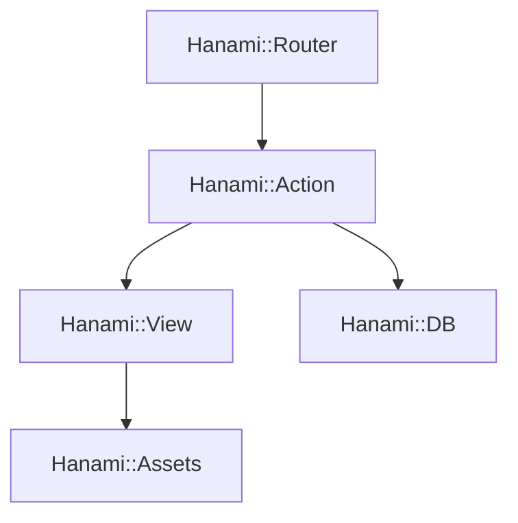

# hanami/hanami

> Complete Ruby web framework, made of small libraries, for building maintainable applications.

## The problem
Ruby web applications become hard to maintain when everything is mixed together in a single block.

## What it actually does
Glues together single-purpose libraries: a Rack router, actions, views with separate templates, database access (migrations, repositories, relations) and asset management. Each component can be used alone or with the others. A command generates an application.

## How it is wired
Simplified diagram based on the sheet, no diagram provided.


## Trying it
```shell
gem install hanami
hanami new bookshelf
cd bookshelf && bundle
bundle exec hanami dev
# http://localhost:2300
```

## Cost and gotchas
Free. Ruby and Bundler are required: they are not in the list of prerequisites, hence `none` here.

## What it is not
Not Rails: it is a different, modular framework. It is not meant for data processing.

## Alternatives
No alternative named in the README.

## For you
Ignore: a Ruby web framework, of no interest to a data, AI or MLOps profile unless your team already writes Ruby.
