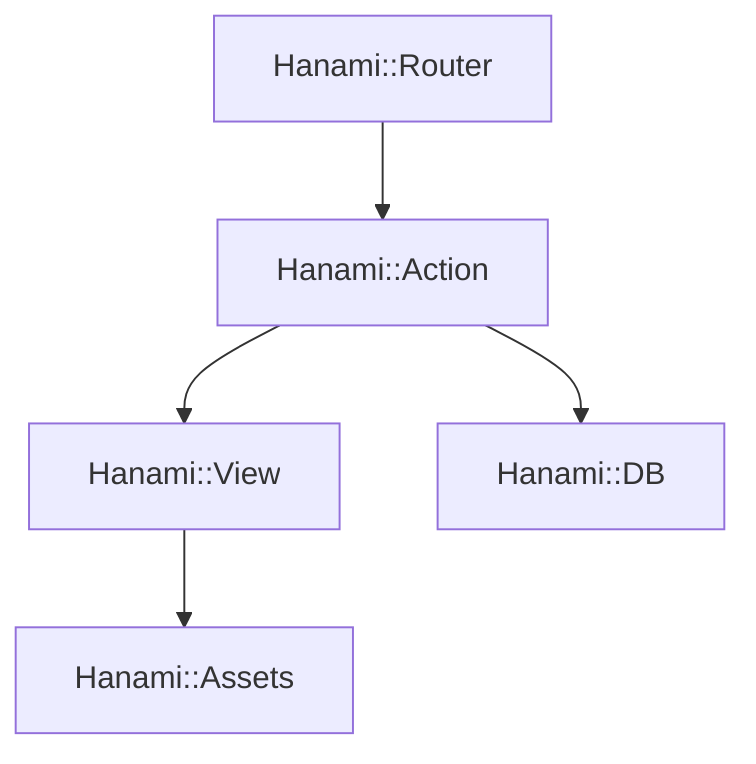

# hanami/hanami

> Framework web Ruby complet, fait de petites bibliothèques, pour construire des applications maintenables.

## Le problème
Les applications web Ruby deviennent difficiles à maintenir quand tout est mêlé dans un seul bloc.

## Ce que ça fait vraiment
Colle ensemble des bibliothèques à usage unique : routeur Rack, actions, vues avec templates séparés, accès aux bases (migrations, dépôts, relations) et gestion des assets. Chaque composant s'utilise seul ou avec les autres. Une commande génère une application.

## Comment c'est branché
Schéma simplifié d'après la fiche, sans diagramme fourni.


## Essayer
```shell
gem install hanami
hanami new bookshelf
cd bookshelf && bundle
bundle exec hanami dev
# http://localhost:2300
```

## Coût et pièges
Gratuit. Ruby et Bundler sont requis : ils ne figurent pas dans la liste des prérequis, d'où `aucun` ici.

## Ce que ce n'est pas
Ce n'est pas Rails : c'est un autre framework, modulaire. Il ne sert pas aux traitements de données.

## Alternatives
Aucune alternative nommée dans le README.

## Pour toi
À ignorer : framework web Ruby, sans intérêt pour un profil data, IA ou MLOps sauf si ton équipe écrit déjà du Ruby.

