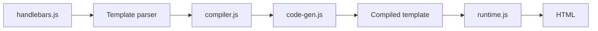

# handlebars-lang/handlebars.js

> Semantic JavaScript templating engine, nearly Mustache-compatible, for web developers.

## The problem
Generating HTML from data without mixing logic and presentation.

## What it actually does
`Handlebars.compile` turns a template into a function that takes a context. Adds to Mustache nested paths, helpers, blocks, literals and comments. Templates can be precompiled (CLI) with a standalone runtime for faster startup. Property-access guards and safe strings for escaping. Benchmark suite provided.

## How it is wired


## Trying it
```js
var template = Handlebars.compile(source);
var result = template(data);
```
```bash
pnpm run bench
```

## Cost and gotchas
Free. Differences from Mustache: no recursive lookup by default (`compat` option, slower), no Mustache lambdas, no alternate delimiters.

## What it is not
Not a view framework: a template engine. The install command is not in the README provided.

## Alternatives
No alternative named in the README (Mustache is cited as the compatibility base).

## For you
Useful for generating reports or e-mails from data; you only need it if your pipeline is in JS.
