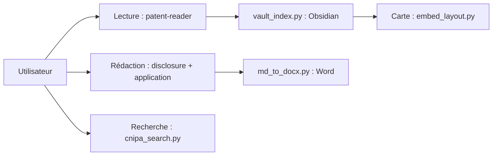

# handsomestWei/patent-disclosure-skill

> Set of agent skills: drafting Chinese patents, reading patents, mapping them and answering examinations.

## The problem
An inventor rarely knows how to identify patentable points, write the invention disclosure or understand a published patent.

## What it actually does
Eight sub-skills: invention disclosure (invention, utility model, drawing), application file, file session, plain-language reading with Obsidian archiving, patent map, examination response help, CNIPA bibliographic search and policy bulletin. The scripts include Word export, file validation, embeddings and CNIPA search.

## How it is wired

## Trying it
No install command in this README: see "详细安装说明" (detailed installation instructions), cited without content.

## Cost and gotchas
Free, but the search relies on the CNIPA service. Plain-language reading uses Obsidian as an option. The repo dates from April 2026.

## What it is not
Not legal advice: it helps with drafting, a patent attorney must validate. README mostly in Chinese, focused on Chinese law.

## Alternatives
- No alternative named in the README.

## For you
Worth watching: an example of an agent skill collection for a business domain, useful as an organization model, with no direct use outside Chinese patents.
