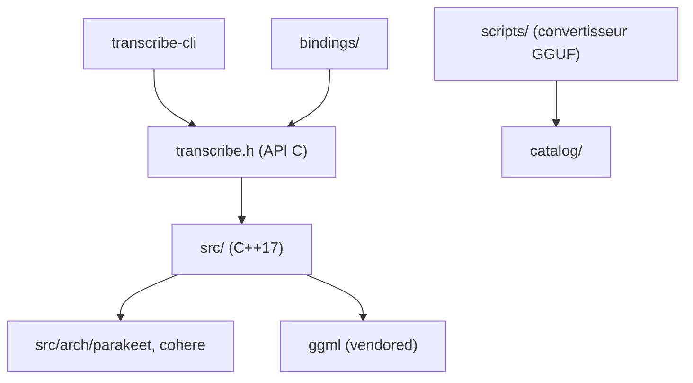

# handy-computer/transcribe.cpp

> A C/C++ speech transcription library that runs many model families in GGUF format on ggml.

## The problem
Each speech recognition model (Whisper, Parakeet, Moonshine...) has its own inference code, often tied to Python and to a single GPU vendor.

## What it actually does
It runs 16 model families and more than 60 variants, in streaming or batch mode, on CPU (tinyBLAS), Metal, Vulkan, CUDA and ROCm. It also handles diarization, language identification and voice activity detection. Pre-converted GGUFs are on Hugging Face, with a quantization tool. Bindings exist for Python, TypeScript, Rust and Swift.

## How it is wired


## Trying it
```bash
cmake -B build
cmake --build build
build/bin/transcribe-cli -m models/parakeet-tdt-0.6b-v2/parakeet-tdt-0.6b-v2-F32.gguf samples/jfk.wav
```

## Cost and gotchas
Free, but to be built with CMake, with the Vulkan, CUDA or ROCm SDK depending on the card. Input must be a mono 16 kHz WAV: `ffmpeg` converts other formats. Models of 1 to 24 billion parameters require memory accordingly.

## What it is not
It is not a transcription service: you host everything. It is not a simple clone of whisper.cpp: the README highlights many model families, verified by WER.

## Alternatives
No alternative named in the README.

## For you
Worth watching if you want local multi-model, multi-GPU speech inference: coverage is broad and the models are tested, but the project is young (April 2026).
