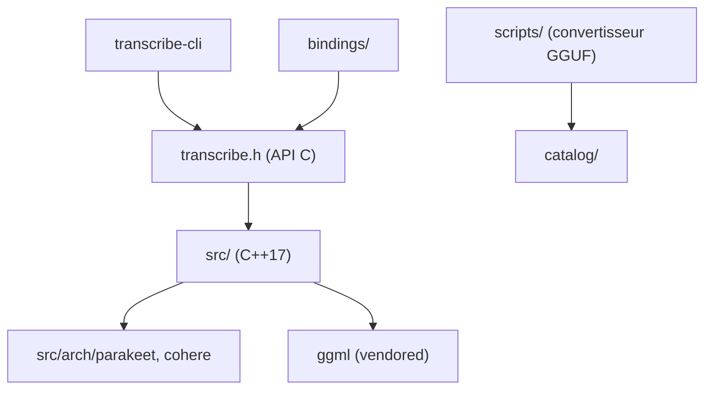

# handy-computer/transcribe.cpp

> Bibliothèque C/C++ de transcription vocale qui exécute de nombreuses familles de modèles au format GGUF sur ggml.

## Le problème
Chaque modèle de reconnaissance vocale (Whisper, Parakeet, Moonshine...) a son propre code d'inférence, souvent lié à Python et à un seul fabricant de GPU.

## Ce que ça fait vraiment
Elle exécute 16 familles de modèles et plus de 60 variantes en streaming ou par lot, sur CPU (tinyBLAS), Metal, Vulkan, CUDA et ROCm. Elle gère aussi la diarisation, l'identification de langue et la détection d'activité vocale. Des GGUF préconvertis sont sur Hugging Face, avec un outil de quantification. Des liaisons existent pour Python, TypeScript, Rust et Swift.

## Comment c'est branché


## Essayer
```bash
cmake -B build
cmake --build build
build/bin/transcribe-cli -m models/parakeet-tdt-0.6b-v2/parakeet-tdt-0.6b-v2-F32.gguf samples/jfk.wav
```

## Coût et pièges
Gratuit, mais à compiler avec CMake, avec le SDK Vulkan, CUDA ou ROCm selon la carte. L'entrée doit être un WAV mono 16 kHz : `ffmpeg` convertit les autres formats. Les modèles de 1 à 24 milliards de paramètres exigent de la mémoire en conséquence.

## Ce que ce n'est pas
Ce n'est pas un service de transcription : tu héberges tout. Ce n'est pas un simple clone de whisper.cpp : le README met en avant de nombreuses familles de modèles, vérifiées par WER.

## Alternatives
Aucune alternative nommée dans le README.

## Pour toi
À surveiller si tu veux une inférence vocale locale multi-modèles et multi-GPU : la couverture est large et les modèles sont testés, mais le projet est jeune (avril 2026).

