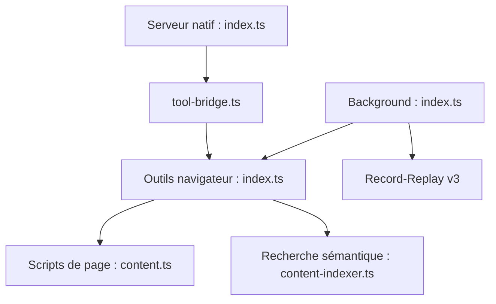

# hangwin/mcp-chrome

> Chrome extension that exposes your real browser to an AI via MCP, to automate and analyze pages.

## The problem
Playwright-based MCP servers launch a clean browser, without your sessions or settings.

## What it actually does
An extension drives the browser (screenshots, network, console, history, bookmarks, clicks, typing); a local Node server connects it to MCP clients over streamable HTTP or stdio. A local semantic search across tabs uses a vector database and WASM SIMD. Two record-and-replay engines (v2 and v3) exist.

## How it is wired


## Trying it
```bash
npm install -g mcp-chrome-bridge
mcp-chrome-bridge register
```
Then load the unpacked extension in `chrome://extensions/` and use `http://127.0.0.1:12306/mcp`.

## Cost and gotchas
Free, Node 20 or later. The AI acts with your logged-in sessions: the risk is yours. pnpm disables postinstall scripts by default.

## What it is not
Not a headless browser or a reliable testing tool: the README speaks of an early stage. Last push in January 2026.

## Alternatives
Playwright: cited as a comparison, more isolated but without your sessions.

## For you
Worth watching: useful for agents on your browser, but single maintainer and session security to consider.
