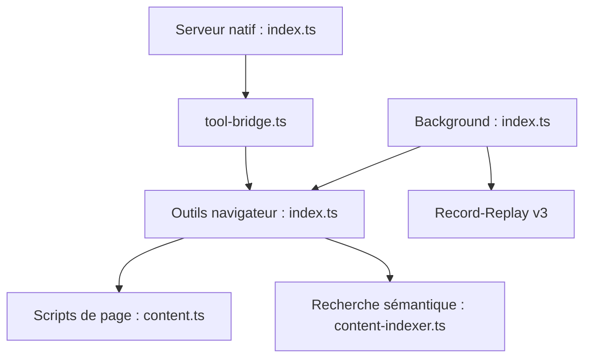

# hangwin/mcp-chrome

> Extension Chrome qui expose ton navigateur réel à une IA via MCP, pour automatiser et analyser des pages.

## Le problème
Les serveurs MCP basés sur Playwright lancent un navigateur propre, sans tes sessions ni tes réglages.

## Ce que ça fait vraiment
Une extension pilote le navigateur (captures, réseau, console, historique, favoris, clics, saisie) ; un serveur Node local la relie aux clients MCP en HTTP streamable ou stdio. Une recherche sémantique locale sur les onglets utilise une base vectorielle et du WASM SIMD. Deux moteurs d'enregistrement-rejeu (v2 et v3) existent.

## Comment c'est branché


## Essayer
```bash
npm install -g mcp-chrome-bridge
mcp-chrome-bridge register
```
Puis charger l'extension non empaquetée dans `chrome://extensions/` et utiliser `http://127.0.0.1:12306/mcp`.

## Coût et pièges
Gratuit, Node 20 ou plus. L'IA agit avec tes sessions connectées : le risque est à ta charge. pnpm désactive les scripts postinstall par défaut.

## Ce que ce n'est pas
Pas un navigateur sans tête ni un outil de test fiable : le README parle de stade précoce. Dernier push en janvier 2026.

## Alternatives
Playwright : cité en comparaison, plus isolé mais sans tes sessions.

## Pour toi
À surveiller : utile pour des agents sur ton navigateur, mais mainteneur unique et sécurité des sessions à considérer.

